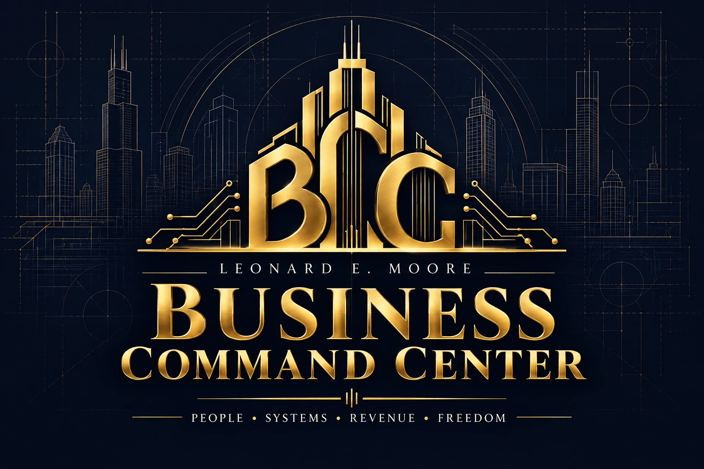
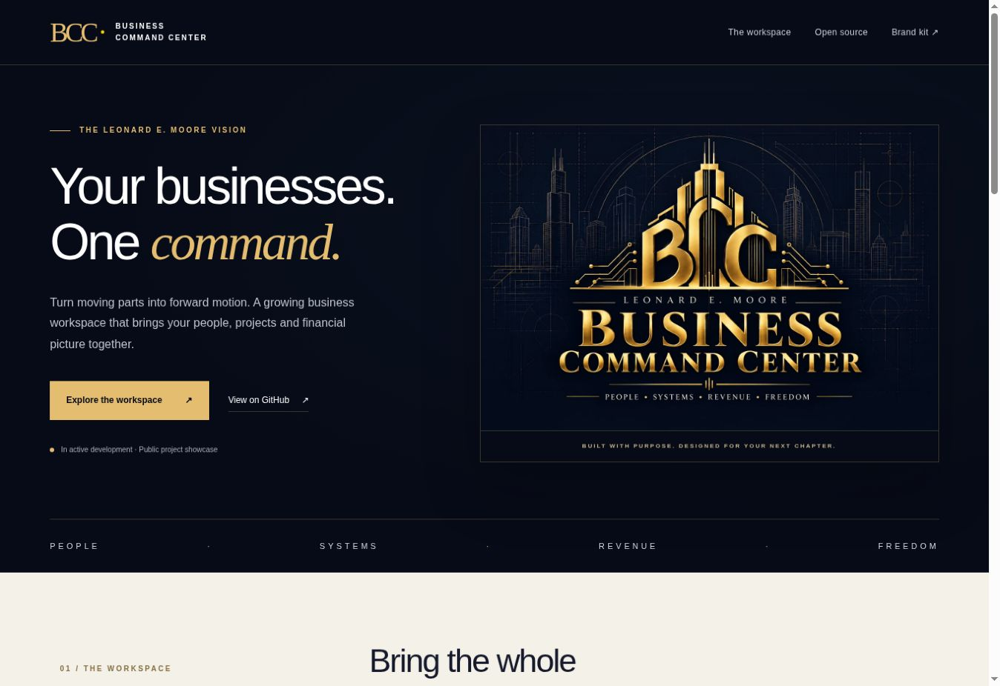

# Business Command Center



**People. Systems. Revenue. Freedom.**

The official public project website and brand kit for Leonard E. Moore's Business
Command Center. The application brings business profiles, leads, projects,
tasks, invoices, recorded payments, portal tools and preparation workflows into
one workspace.

This repository contains the **static showcase website and public branding only**.
The application source, credentials, database and customer records remain in the
separate private application repository.

## Website

Live GitHub Pages website:
https://mooreliving777.github.io/business-command-center/

The site uses plain HTML and CSS, local artwork, no JavaScript dependencies,
no analytics, no cookies and no data collection forms.

To preview locally:

```sh
python -m http.server 8080
```

Then open http://localhost:8080.

## Website preview



## Brand kit

- [Cover artwork, 1536 × 1024 WebP](assets/command-center-cover.webp)
- Midnight navy: `#0A0A23`
- Signature gold: `#FFD700`
- Display gold: `#E5BD70`
- Ivory: `#F4F1E9`

The original cover was created with the built-in image-generation tool.
Creative brief: luxury navy-and-gold Business Command Center branding for
Leonard E. Moore; Chicago-inspired architectural BCC emblem; exact name and
“People • Systems • Revenue • Freedom” tagline; no dashboard metrics or devices.
The WebP is a web-optimized format conversion of the generated cover.

## Development status

Core workflows are described on the website as application-code capabilities,
not a claim of an activated deployment. Payroll is preparation-only; invoice
payments are manually recorded.

The open-source-only Bifrost gateway integration is **draft, unmerged and not
deployed** at the time of this site's creation. Gateway software, exact model
artifacts, licenses, routing and server resources require deployment verification.
This public website is not a working app login, AI gateway, payment processor
or payroll service.

## GitHub Pages

In repository Settings → Pages, use **Deploy from a branch**:
`main` and `/ (root)`. The included `.nojekyll` serves static assets directly.
Only static public project files are included.

## Licensing

The static website code (HTML, CSS, favicon SVG) is available under
[the MIT license](LICENSE). The cover artwork, names, brand identity and
trademarks are excluded from that code license and reserved to Leonard E. Moore,
to the extent rights exist. No license to use the brand as your own is granted.
The private application is not relicensed or disclosed by this repository.
